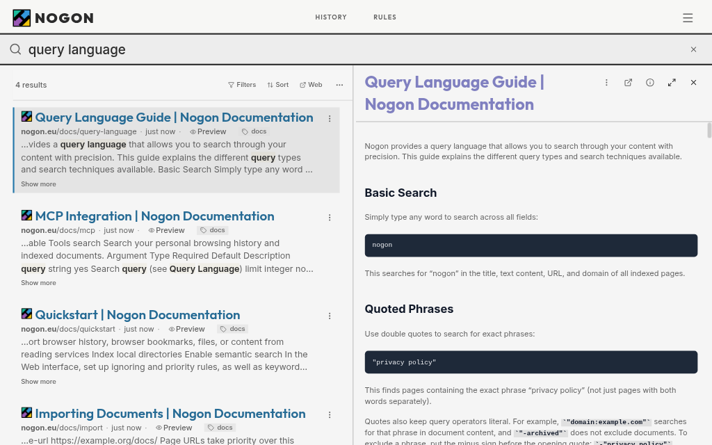
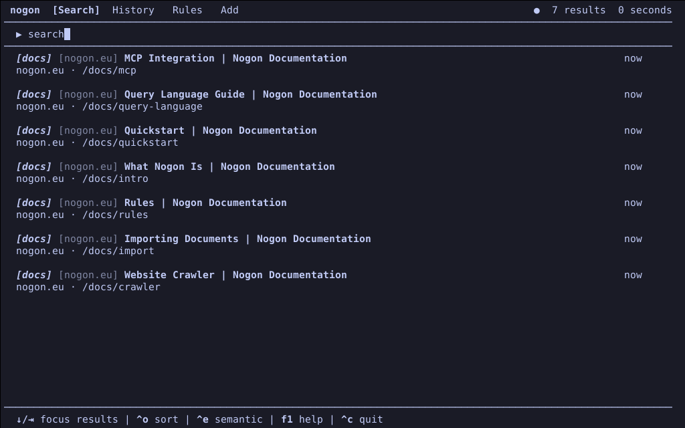

# Nogon

**Your own search engine**

Nogon was formerly known as Hister. Some downloads, packages, and public links still use the Hister name.

Nogon is a private search engine for the pages you visit and the files you keep. It indexes their full contents so you can find information again from the web interface, terminal, or an AI assistant connected through MCP.

[Try the demo](https://demo.hister.org/) · [Download Nogon](https://github.com/asciimoo/hister/releases/latest) · [Read the quickstart](https://hister.org/docs/quickstart) · [Documentation](https://hister.org/docs) · [Support the development](https://hister.org/support)



## Quickstart

1. Download the binary for your platform from the [latest release](https://github.com/asciimoo/hister/releases/latest), then rename it to `nogon` (`nogon.exe` on Windows).

2. On Linux or macOS, make it executable:

   ```bash
   chmod +x nogon
   ```

3. Start Nogon on Linux or macOS:

   ```bash
   ./nogon listen
   ```

   On Windows, run `.\nogon.exe listen` in PowerShell.

   Keep this terminal open while using Nogon. The server must be running to index pages and search them.

4. Open <http://127.0.0.1:4433> and install the browser extension for [Firefox](https://addons.mozilla.org/en-US/firefox/addon/hister/) or [Chrome](https://chromewebstore.google.com/detail/hister/cciilamhchpmbdnniabclekddabkifhb).

5. Visit a web page with the extension enabled, then return to Nogon and search for a phrase from that page to find your first indexed result.

No configuration is required for a local personal setup. See the [complete quickstart](https://hister.org/docs/quickstart) to choose what Nogon indexes.

To search existing content, [import browser history](https://hister.org/docs/import#importing-browser-history), [import browser bookmarks](https://hister.org/docs/import#importing-browser-bookmarks), [index local directories](https://hister.org/docs/configuration#local-directory-indexing), or [import files](https://hister.org/docs/import#importing-files).

Alternative installation methods include Homebrew (`brew install hister`), Docker, and Nix. See the [installation guide](https://hister.org/docs/installing) for instructions.

## Features

- **Privacy focused**: No telemetry or mandatory cloud service. Run Nogon locally or on infrastructure you control.
- **Full text indexing**: Search the actual contents of visited pages and local files, not only titles and URLs.
- **Automatic browser indexing**: Save newly visited pages with the Firefox or Chrome extension.
- **Powerful queries**: Use field filters, phrases, wildcards, negation, aliases, and result priorities.
- **Optional semantic search**: Find documents by meaning through an embeddings endpoint you configure.
- **Crawler and browser import**: Index websites or bring in existing browser history and bookmarks.
- **Web, terminal, and MCP clients**: Search from the browser, TUI, command line, or an AI assistant.
- **Multi user support**: Keep each user's documents and search results separate on a shared server.



## Privacy

By default, Nogon has no telemetry and no cloud sync. The browser extension sends indexed page content only to the Nogon server you configure, apart from downloading page favicons. The server stores documents and search indexes on that server.

Optional semantic search sends document text to the embeddings endpoint you choose. Review the [privacy overview](https://hister.org/docs/intro#privacy) and [semantic search configuration](https://hister.org/docs/configuration#semantic-search) before enabling remote integrations.

<a id="why-hister"></a>

## Why Nogon?

Unlike traditional search engines, Nogon builds a personal search index from the web pages and files you choose to keep. Your content stays on your Nogon server, making it useful for finding information you've already encountered without relying on a third-party search provider.

## Development

Requirements are Go 1.26, npm, and a C compiler for CGO dependencies.

```bash
git clone https://github.com/asciimoo/hister.git
cd hister
./manage.sh build
```

To work on the web app with hot reload and automatic Go rebuilds:

```bash
npm run serve:app
```

This starts a Vite development server and the Go backend with automatic rebuilds through [air](https://github.com/air-verse/air).

## Community and contributing

Join us on IRCNet in `#hister` or on [Discord](https://discord.gg/beEyuHxRSs).

Read [CONTRIBUTING.md](CONTRIBUTING.md) before submitting a change. Bugs and suggestions belong in the [issue tracker](https://github.com/asciimoo/hister/issues). For security reports, see [SECURITY.md](SECURITY.md).

## Sponsors

[](https://uruky.com/)

## License

[AGPLv3](LICENSE) or any later version
