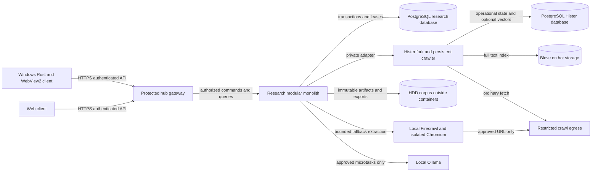

# Target architecture and workflow contracts

## Deployment view — proposed, not observed

This is a UML-like component view in Mermaid for implementers; the prose below is its text alternative. GitHub-compatible Mermaid is the intended renderer; no rendering was verified in this pass. A plain component table is the fallback for readers without a renderer. It describes proposed relationships, not discovered NAS wiring.

Only gateway HTTPS is externally reachable through protected Cloudflare access. Gateway terminates identity, rate limits and authorization; internal calls carry a scoped mapped principal, not arbitrary client-supplied user IDs. Hister, PostgreSQL, Firecrawl, Chromium, Ollama, metrics and worker controls stay private. NAS mounts are not web roots. Cloudflare account, tunnel, DNS and access configuration are unverified and must not be changed during this pass.

Research modules: identity/ACL, jobs/intake, source catalog/artifacts, orchestration/outbox, Hister adapter, search/profiles, evidence/review, rules/deletion, exports and receipts/health. Use a single research deployment and one durable database, with worker concurrency inside that application or its same-binary worker mode. Avoid Redis/Kafka and separate services for individual research stages. Use isolated browser containers because hostile page execution has a different security boundary. Reuse Hub operational infrastructure after inspection instead of replacing it.

## Source acceptance and search transaction

1. Authorize intake, freeze job scope/version and source permissions, validate URL or upload root, reserve quota. Assign UUIDs and receipt ID. Do not fetch on a read-only search request.
2. Stream bytes to same-filesystem temporary artifact; enforce compressed/decompressed limits, calculate SHA-256, fsync, atomically rename to content path. Verify hash and mark artifact ready. Failed DB transaction can leave an orphan; reconcile after a grace period. Never commit ready state before durable bytes exist.
3. In one research transaction insert document/location/version, job membership, immutable retrieval receipt and outbox event `document.accepted`. A repeated idempotency key with identical input returns the same result; conflicting body returns 409. A document can be accepted while indexing is pending.
4. Worker claims event using `FOR UPDATE SKIP LOCKED`, lease token and deadline. Adapter submits normalized text and metadata to Hister with `(tenant,document,version,index-generation)` as logical key. Keep original URI and stable research UUID; Hister ID is an adapter mapping, never the canonical identity.
5. After Hister acknowledgment and a revision/mapping check, commit searchable mapping and receipt. If crash occurs before this commit, replay the same payload. Do not mark done just because Hister returned 200; verify not skipped, expected owner and version. Add an explicit idempotent acknowledgment to the fork when existing API cannot provide this. Preserve current `/api/add` for existing clients.
6. Retry transient errors with jittered backoff (1s base, 5m ceiling, eight attempts default); quarantine permanent validation errors. Dead letters remain visible/retryable. Daily/on-demand reconcile accepted versions versus active Hister mappings; repair only authorized missing/stale mappings. Never use at-most-once delivery.

Cross-database atomic commits are not assumed. Research outbox is authority; Hister is a reconstructible retrieval projection plus its native crawler/history functions. For Hister-origin intake, the crawler processing callback must durably accept the source into research before acknowledging frontier completion; research indexing then happens asynchronously. Implement a narrow callback/adapter seam and receipt linkage, not a second frontier scheduler.

Before the crawl callback seam exists, the first slice supports supplied files/folder manifests and bounded approved URL intake through the research endpoint, including duplicate and category previews, and does not pretend direct Hister browser/CLI ingestion is research-complete. Phase 2 routes the remaining native intake paths through the seam. A reconciliation importer can discover historical Hister entries with explicit origin/limited-capture receipts; it cannot invent missing originals.

## Research jobs and crawl-this

Job holds purpose, three independent scopes, profile version, stage DAG, policies, revisions and output snapshots. Source scope covers files, roots, URLs, domains, saved searches and inherited job snapshots. Processing scope is an explicit stage list. Publication scope is per-document permission and approved collection/export state; membership never grants broader visibility. Inherited jobs freeze membership at revision; refresh is an explicit new job revision, with cycle rejection.

Stages: crawl/intake → extract → exact deduplicate → normalize/name → lossless-summary → classify → claim-map → score → review → export. Stages can be omitted explicitly. Human review is not automatically completed by a model. Ordinary category assignments may be applied by an explicitly enabled calibrated policy under the bands in [the product contract](00-product-contract.md); this does not confer human approval or canon. A lossless summary is a navigational projection with coverage links and explicit omissions, never a substitute for original text or a promise of mathematical losslessness. Store model/prompt/input hashes, output version and exact passage links; report dropped qualifiers.

`Crawl this` accepts query snapshot, selected result IDs, domain, URL list or job scope. Preview resolves authorized seeds and freezes rules/hash. Defaults: max 200 pages, depth 2, two concurrent fetches total and one per domain, minimum 2s per-domain delay, robots enforced, HTTP first, no paid backend, 2 GiB artifacts, 20 MiB response and 60s per attempt. Limits are proposals editable before confirmation. Honor Retry-After and stricter robots constraints. A query is discovery input, not authority to follow every found link.

Map crawl execution to Hister persistent frontier (`pending/in_progress/done/failed/skipped`). Research execution adds queued/pausing/paused/blocked/cancelled and leases; don't silently equate Hister interrupted with user pause. Pause stops scheduling, waits for in-flight accepted writes, releases leases and records checkpoint. Cancel preserves sources and receipts. Resume reuses stored scope with explicit version; scope expansion creates another execution. Expired leases are reclaimed; fencing prevents a stale worker completing work after reassignment.

Counts: frontier pending/in-progress; completed fetched; failed; skipped with reason; byte duplicates; newly discovered URLs; accepted unique document versions; analyzed versions. A URL done is not a claim analyzed. Each wave snapshots deltas of unique documents, domains, reviewed novel claims and evidence edges. Proposed soft stop: three waves of at least 20 attempted pages each with <5% new unique documents and no new reviewed claims/edges; show counts and uncertainty, offer continuation within hard bounds. Before claim review exists use document/domain saturation only and label claim metrics unavailable. Never claim exhaustive web coverage.

## Extraction backend contract

Research owns policy, source identity, artifacts and receipts; Hister owns ordinary retrieval/crawl traversal. Firecrawl is an extraction companion, not another evidence database or autonomous frontier. Initially use single-page extraction. Whole-site mode is deferred unless its discovered URLs are imported into Hister's durable frontier and every fetch enforces the same rules; disable independent unbounded crawling.

Internal request: `{request_id, document_id, source_url, expected_scope_hash, backend, timeout_ms, max_bytes, formats:[html,markdown,text], capture_policy, credential_ref?}`. Response: `{request_id, final_url, redirect_chain, fetched_at, http_status, media_type, artifacts:[kind,sha256,size,internal_uri], extracted_text, extractor_version, warnings, discovered_urls, usage:{duration_ms,bytes}, error?}`. Adapter checks returned IDs, redirect scope, checksums and text encoding. Credentials are references scoped to approved destination, never response fields. Models never receive cookies.

Fallback policy: Hister HTTP success with usable text wins; script-required/empty extraction may try isolated Chromium if approved; difficult extraction may try local Firecrawl if allowed; blocked robots/auth/paywall/403 never trigger evasion. 429 backs off, transient 5xx retries within budget, unsafe redirects fail closed. Retain all attempts and chosen output with version, reason and hashes. Set 60s/20 MiB per attempt and two total fallback attempts by default, under job-wide budgets. Side effects from extractor “extra documents” require the same URL/root validation and receipts. Preserve original response even if normalized output differs. Browsertrix/WARC is a later opt-in preservation stage; it does not retroactively make earlier captures preservation-grade.

## Windows client

Preserve Rust/WebView2 shell as a candidate; its code was not available to validate. It calls gateway `/v1`, not raw NAS ports. Discover instance identity/capabilities through authenticated orientation; pin selected instance and reject mismatched IDs. Browser bearer/session flows use system browser OIDC authorization code with PKCE where supported, short-lived tokens and Windows Credential Manager; no password or long-lived service token in WebView localStorage. Enforce WebView origin navigation allowlist and minimal native bridge.

Screens: Search; Jobs and stage details; Collections; Add; Crawls/frontier/errors; Rules/Exclusions; Claims/Evidence; Review Queue; Storage/Cache; System Health. Persistent job context and scope controls remain visible. Search supports this job, selected jobs, all authorized corpus, local plus live discovery, and refine-result snapshots. Review shows passage alongside claim/edge, assessor and disagreements.

Add routes: native files (chunked/resumable upload + SHA-256); folders/drives/UNC (enumerate only user-approved roots, respect exclusions and symlinks, upload a frozen manifest); links/lists/sitemaps/RSS/sites (scope preview); collection creation/import (schema and duplicate preview). `D:\...` is never a NAS path. For NAS-resident roots use server-side allowlisted mount IDs and relative paths. Renames preserve identity through agent file IDs plus content history; identical bytes at different locations keep separate provenance.

Normal mode shares canonical jobs/rules/status. Optional local/private mode has a clearly different instance/tenant, storage and search indicator; it never silently synchronizes private files. Offline cache is bounded/encrypted and displays freshness. Queue only reversible drafts offline; deletion, canon approval, publication and spend require live authorization. Reconcile reconnect edits using ETag/revisions and show conflicts. Native bridge never exposes arbitrary shell commands or filesystem paths to crawled content.

Idle worker starts only for approved microtask types after 15 minutes of the initiating user's observed idle time. On Windows use OS activity; web focus alone cannot prove machine idle. If activity status is unknown, pause. On multiuser NAS, one idle user cannot authorize actions on another user's corpus. Heartbeat every 5s; foreground return immediately cancels scheduling and signals cooperative cancellation of active local inference (target <1s; if backend cannot cancel, discard result and report residual resource use). Bound to one task, 2 CPU cores, 2 GiB worker memory and a configurable local-model budget initially; inspect hardware before enabling GPU workloads. Never run move/delete/publish/message/canon or paid calls in idle mode. Persist every attempted task, including cancellation.

## Desktop-first refinement

[The product contract](00-product-contract.md) defines folder drag/drop, spreadsheet intake, combined desktop/NAS search, duplicate review, category automation and `999_ARCHIVE`. These are product requirements, not raw Hister configuration screens. Manual/proposed classification and native desktop search now belong in phase 1; unattended classification remains gated.
